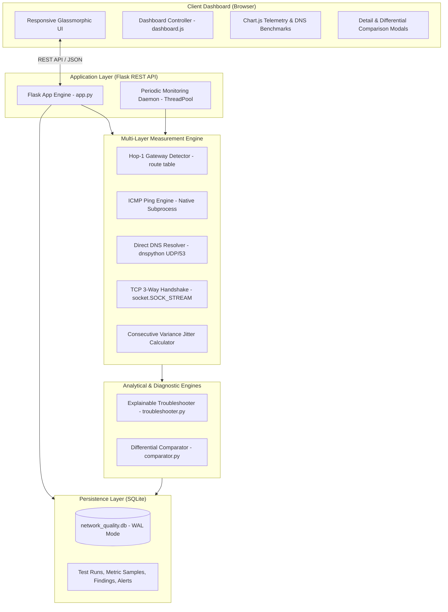

# NetPulse — Internet Quality Analyzer & Connection Troubleshooter

[](https://www.python.org/)
[](https://flask.palletsprojects.com/)
[]()
[](https://opensource.org/licenses/MIT)

> An explainable, multi-layer Computer Networks diagnostic platform that evaluates network health, isolates Wi-Fi/LAN vs. WAN/ISP bottlenecks, benchmarks DNS resolvers and TCP establishment, provides deterministic root-cause troubleshooting, and offers differential session comparison.

---

## 📌 1. Project Motivation & Core Differentiator

Most commercial network speed tests measure **bulk throughput** (Megabits per second download/upload) and an aggregate ping. However, real-time application failures—such as Zoom/Teams freezing, gaming packet loss spikes, audio clipping, and slow website initial page loads—are rarely caused by bandwidth saturation alone. They are typically driven by:

- **Unstable packet delay (Jitter / Bufferbloat)**
- **Intermittent micro-packet loss**
- **Slow DNS resolution (L7 UDP/53 latency)**
- **Elevated TCP 3-way handshake delays (L4 connection establishment)**
- **Local Wi-Fi link degradation (Hop-1 Gateway bottleneck)**

### How NetPulse Differs from Traditional Speed Tests
| Feature | Traditional Speed Test | NetPulse.io |
| :--- | :--- | :--- |
| **Primary Metric** | Maximum bandwidth capacity (Mbps) | Latency stability, jitter, loss, and handshake timings |
| **Fault Isolation** | None (Single aggregated score) | **Differential analysis** (Hop-1 Gateway vs. External WAN) |
| **Layered Diagnostics**| L7 HTTP throughput only | **L2/L3 (Gateway), L3 (ICMP), L4 (TCP), L7 (DNS)** |
| **DNS Assessment** | Uses cached OS resolver | **Direct UDP queries to Anycast resolvers bypassing cache** |
| **Troubleshooting** | None / Vague tips | **Deterministic rule engine with quantitative evidence** |
| **Session Comparison** | Basic speed test log | **Per-target $\Delta$ variance comparison with trend analysis** |
| **Data Privacy** | Sends telemetry to third-party | **100% local SQLite database with RFC 4180 CSV export** |

---

## 🏛️ 2. System Architecture



---

## 📐 3. Mathematical & Networking Formulations

### A. Jitter (Consecutive Round-Trip Time Variance)
NetPulse calculates statistical jitter as the mean absolute difference between consecutively received probe round-trip times:
$$\text{Jitter} = \frac{1}{M - 1} \sum_{i=1}^{M - 1} |RTT_{i+1} - RTT_i|$$

- **Gap-Preserving Rule:** If a packet is lost (dropped probe), the algorithm does not fabricate a zero or interpolate artificially. In strict mode, gaps between non-consecutive probes are skipped ($M$ is the count of consecutive valid pairs) to ensure mathematical fidelity.

### B. Packet Loss Percentage
$$\text{Packet Loss \%} = \left(\frac{\text{Probes Sent} - \text{Probes Received}}{\text{Probes Sent}}\right) \times 100$$

### C. Differential WAN Latency Penalty
$$\text{WAN Penalty} = \text{RTT}_{\text{external}} - \text{RTT}_{\text{gateway}}$$
Because every outbound frame must first cross the local LAN or Wi-Fi hop to reach the default gateway, the gateway latency acts as the baseline floor. Subtracting hop-1 gateway RTT isolates the latency incurred specifically on the ISP backhaul and internet backbone.

### D. Transport Layer Protocol Overhead
$$\text{Protocol Overhead} = \text{TCP 3-Way Handshake Time} - \text{ICMP RTT}$$
- ICMP Echo (L3) is handled immediately by remote kernel IP stacks.
- TCP 3-Way Handshake (L4) requires a complete `SYN` -> `SYN-ACK` -> `ACK` exchange plus server socket accept queue processing. Under normal conditions, $\text{TCP} \approx \text{ICMP}$. A large positive overhead reveals server listen backlog queue delays or stateful firewall deep packet inspection.

### E. Differential Session Comparison ($\Delta \text{Metric}$)
$$\Delta \text{Metric} = \text{Metric}_{\text{Run B}} - \text{Metric}_{\text{Run A}}$$
Negative deltas in latency, jitter, or packet loss indicate genuine performance improvements between test sessions.

---

## 🔍 4. Multi-Layer Diagnostic Protocol Coverage

1. **L2/L3 Default Gateway Auto-Detection ([network/gateway_detector.py](file:///c:/Users/anand/OneDrive/Documents/projects/Sign_Language/internet-quality-analyzer/network/gateway_detector.py)):**
   - Discovers the default gateway via Windows routing table lookup (`route print 0.0.0.0`).
   - Retrieves active local interface IP and MAC information.
2. **L3 ICMP Probe Engine ([network/ping_test.py](file:///c:/Users/anand/OneDrive/Documents/projects/Sign_Language/internet-quality-analyzer/network/ping_test.py)):**
   - Sends discrete ICMP Echo Requests with monotonic timing.
   - Parses output line-by-line using regex to preserve sample sequences and distinguish sub-millisecond replies from drops.
3. **L4 TCP 3-Way Handshake ([network/tcp_test.py](file:///c:/Users/anand/OneDrive/Documents/projects/Sign_Language/internet-quality-analyzer/network/tcp_test.py)):**
   - Creates a non-blocking `socket.SOCK_STREAM` socket.
   - Measures elapsed time from `connect()` invocation until successful connection completion.
4. **L7 DNS Direct Resolver Queries ([network/dns_test.py](file:///c:/Users/anand/OneDrive/Documents/projects/Sign_Language/internet-quality-analyzer/network/dns_test.py)):**
   - Direct UDP/53 queries to nameservers (`1.1.1.1`, `8.8.8.8`, `9.9.9.9`) using `dnspython`.
   - Bypasses local operating system DNS cache to measure genuine network resolver turnaround time.
5. **Rule-Based Troubleshooter ([analysis/troubleshooter.py](file:///c:/Users/anand/OneDrive/Documents/projects/Sign_Language/internet-quality-analyzer/analysis/troubleshooter.py)):**
   - 11 deterministic diagnostic rules evaluating concrete threshold breaches.
   - Outputs structured findings with:
     - **Symptom:** Plain-English summary of what degraded.
     - **Quantitative Evidence:** Concrete metrics, thresholds, and target names.
     - **Possible Causes:** Technical root-cause possibilities.
     - **Recommendations:** Step-by-step remediation actions.
     - **Confidence Level:** High, Moderate, or Low.
     - **Documented Limitations:** Caveats acknowledging router firewall behaviors or routing vagaries.

---

## 🗄️ 5. Database Schema ([database/schema.sql](file:///c:/Users/anand/OneDrive/Documents/projects/Sign_Language/internet-quality-analyzer/database/schema.sql))

NetPulse utilizes an embedded SQLite database configured in Write-Ahead Logging mode (`PRAGMA journal_mode = WAL;`) with foreign keys enabled (`PRAGMA foreign_keys = ON;`).

```
test_runs (id, timestamp_utc, duration_seconds, local_ip, gateway_ip, gateway_detected, overall_status, summary, trigger_type)
    │
    ├── metric_samples (id, test_run_id, target_id, target_name, target_type, target_address, target_port,
    │                   latency_min_ms, latency_max_ms, latency_avg_ms, latency_median_ms, jitter_ms,
    │                   packet_loss_pct, probes_sent, probes_received, dns_lookup_time_ms, tcp_handshake_time_ms,
    │                   samples_json, status, error_message)
    │
    └── diagnostic_findings (id, test_run_id, rule_id, severity, symptom, evidence_json,
                             possible_causes_json, recommendations_json, confidence, limitations)

alerts (id, timestamp_utc, test_run_id, target_id, metric_name, metric_value, threshold_value, severity, message, is_resolved)
```

---

## 🌐 6. REST API Documentation

Base URL: `http://127.0.0.1:5000`

| Method | Endpoint | Description | Query / Body Parameters |
| :--- | :--- | :--- | :--- |
| `GET` | `/api/health` | Service health status and environment details | None |
| `GET` | `/api/config` | Read active thresholds, targets, and resolvers | None |
| `POST` | `/api/config` | Update thresholds dynamically in-memory | `{"thresholds": {...}}` |
| `POST` | `/api/tests` | Execute a live multi-layer diagnostic probe | `{"targets": ["gateway", "google_web"], "probe_count": 5}` |
| `GET` | `/api/tests/<id>` | Retrieve full diagnostic report by run ID | URL parameter: `id` |
| `GET` | `/api/history` | Query historical test runs | `?hours=24&limit=50&target_id=...` |
| `GET` | `/api/stats` | Aggregated summary KPIs (uptime, avg latency) | `?hours=24` |
| `GET` | `/api/alerts` | Query recent threshold breach alerts | `?limit=20` |
| `GET` | `/api/compare` | Head-to-head differential comparison between runs | `?run_a=<id>&run_b=<id>` |
| `GET` | `/api/compare/destinations` | Destination ranking, WAN penalty, protocol overhead | `?run_id=<id>` (optional; defaults to latest) |
| `GET` | `/api/export/csv` | Export historical records as RFC 4180 CSV | `?hours=168` (default 7 days) |
| `GET` | `/api/export/comparison/csv` | Download differential comparison as CSV file | `?run_a=<id>&run_b=<id>` |
| `GET` | `/api/export/comparison/json`| Download differential comparison as JSON file | `?run_a=<id>&run_b=<id>` |
| `GET` | `/api/export/test/<id>/json` | Download single test run report as JSON | URL parameter: `id` |
| `GET` | `/api/monitoring/status` | Current background monitoring daemon status | None |
| `POST`| `/api/monitoring/start` | Start periodic background monitoring daemon | `{"interval_seconds": 300}` |
| `POST`| `/api/monitoring/stop` | Stop periodic background monitoring daemon | None |

---

## 🚀 7. Installation & Quick Start

### Prerequisites
- Python 3.11, 3.12, or 3.13 (Standard CPython)
- Windows 10/11, macOS, or Linux

### 1. Setup Virtual Environment
```powershell
# Clone or navigate to the project directory
cd internet-quality-analyzer

# Create virtual environment
python -m venv .venv

# Activate on Windows (PowerShell)
.\.venv\Scripts\Activate.ps1

# Install requirements
pip install -r requirements.txt
```

### 2. Run Automated Test Suite
```powershell
pytest -v
```
*Expected: 73 passed tests in ~6 seconds.*

### 3. Launch Web Application
```powershell
python app.py
```
Open **`http://127.0.0.1:5000`** in your browser.

---

## 📂 8. Project Directory Structure

```
internet-quality-analyzer/
├── app.py                     # Flask application factory, routes, and REST endpoints
├── config.py                  # Thresholds, target registry, and runtime settings
├── requirements.txt           # Python library dependencies
├── README.md                  # Comprehensive technical documentation
├── VIVA_DEMO_GUIDE.md         # Viva demonstration script & technical interview Q&A
├── network/                   # Measurement engine modules
│   ├── engine.py              # Composite multi-layer probe orchestrator
│   ├── gateway_detector.py    # Default gateway route detection
│   ├── ping_test.py           # ICMP subprocess execution and regex parser
│   ├── dns_test.py            # dnspython direct UDP lookup & benchmarking
│   ├── tcp_test.py            # Non-blocking TCP 3-way handshake measurement
│   └── jitter_calculator.py   # Consecutive sample variance algorithm
├── analysis/                  # Diagnostic and analytical engines
│   ├── troubleshooter.py      # Rule-based explainable diagnostic engine (11 rules)
│   └── comparator.py          # Differential comparison & destination benchmarking
├── database/                  # Data access layer & persistence
│   ├── db.py                  # SQLite DAL, connection pool, and CSV generation
│   └── schema.sql             # Relational schema DDL (WAL mode, indexes, cascades)
├── services/                  # Background worker threads
│   └── monitoring_service.py  # Thread-safe periodic monitoring & alert generator
├── static/                    # Frontend presentation assets
│   ├── css/style.css          # Dark-mode glassmorphic design system
│   └── js/dashboard.js        # Controller, Chart.js integrations, modal managers
├── templates/
│   └── index.html             # Single-page dashboard application template
└── tests/                     # 73-test verification suite
    ├── test_environment.py    # Python, Flask, and dnspython environment checks
    ├── test_jitter.py         # Consecutive jitter & gap handling unit tests
    ├── test_ping.py           # ICMP command formulation & regex parsing tests
    ├── test_dns.py            # DNS resolution and benchmark unit tests
    ├── test_tcp.py            # TCP 3-way handshake timing tests
    ├── test_engine.py         # Composite multi-layer probe integration tests
    ├── test_troubleshooter.py # Rule-based diagnostic decision tests
    ├── test_database.py       # SQLite CRUD, cascades, and CSV export tests
    ├── test_api.py            # Flask REST endpoints integration tests
    ├── test_monitoring.py     # Background worker thread lifecycle tests
    ├── test_comparator.py     # Differential comparator and delta ranking tests
    └── test_validation_scenarios.py # 10 edge-case and failure-mode stress tests
```

---

## ⚠️ 9. Engineering Trade-Offs & Known Limitations

1. **ICMP Privileges on Windows:**
   - On Windows, sending raw ICMP packets via `socket.SOCK_RAW` requires Administrator privileges. To keep the application portable and secure without requiring elevated privileges, NetPulse delegates ICMP probes to the operating system's native `ping` utility with structured regex parsing.
2. **Intermediate Router De-prioritization:**
   - Internet core routers frequently de-prioritize ICMP Echo Requests in their control plane or drop them entirely under load. An ICMP timeout to a remote router does not necessarily prove an application outage, which is why NetPulse combines ICMP with L4 TCP handshakes and L7 DNS queries for multi-dimensional validation.
3. **DNS Query Caching:**
   - Operating system resolver caches (`ipconfig /displaydns`) mask external nameserver delays. NetPulse directly targets upstream nameservers (`1.1.1.1`, `8.8.8.8`) via UDP datagrams to record genuine network turnaround times.
4. **Physical Distance (Propagation Delay):**
   - The speed of light in fiber optic cables (~$200{,}000\text{ km/s}$) imposes an unavoidable propagation floor of roughly $5\text{ms}$ per $1{,}000\text{ km}$ of round-trip distance. NetPulse factors this into its high latency diagnostic rules to avoid false positives for distant servers.

---

## 📜 10. License
This project is licensed under the MIT License — see the LICENSE file for details. Built for Computer Networks academic coursework, engineering demonstrations, and portfolio defense.
